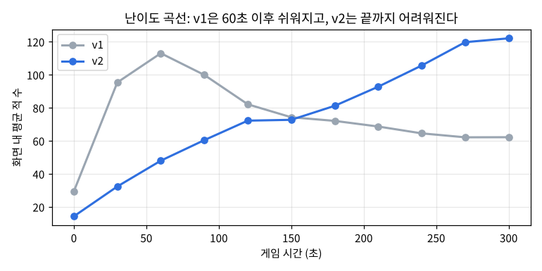
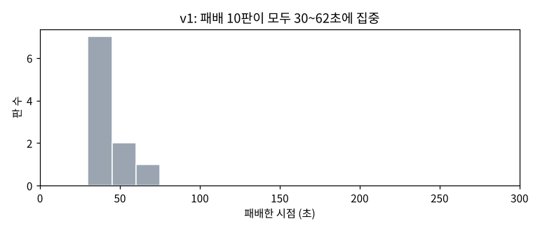
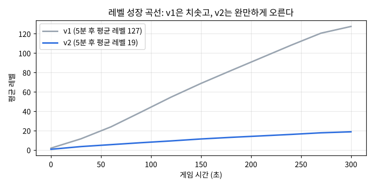
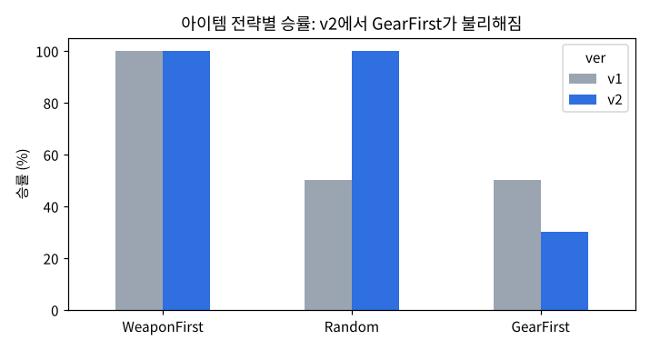

# VampireSurvivor-like: 플레이 데이터로 게임 밸런스 개선하기

Unity로 만든 뱀서라이크 게임에 **플레이 로그 수집 기능**과 **FSM 기반 자동 플레이 봇**을 붙이고,
모은 데이터로 밸런스 문제를 찾아 고친 뒤 **같은 조건으로 다시 측정해 효과를 검증**한 프로젝트입니다.

> 게임의 기본 구조는 [골드메탈의 뱀서라이크 유니티 개발 강좌](https://www.youtube.com/playlist?list=PLO-mt5Iu5TeZF8xMHqtT_DhAPKmjF6i3x)와 에셋(Undead Survivor)으로 익혔습니다.
> 이 저장소의 핵심은 그 위에 **직접 추가한 데이터 수집 · 자동 플레이 · 밸런스 분석** 부분입니다.

| 항목 | 내용 |
|---|---|
| 기간 | 2026.07 게임 구현 (강좌 학습) → 2026.11 데이터 수집 · 분석 · 밸런스 개선 |
| 형태 | 개인 프로젝트 |
| 사용 기술 | Unity 2021.3 (C#), Python (pandas, matplotlib, scipy), SQL (SQLite) |

---

## 한눈에 보기

**문제**: 직접 플레이해 보니 레벨업이 2초마다 일어나고, 10초 이후로 난이도가 오르지 않았습니다.
이걸 "느낌"이 아니라 데이터로 확인하고, 고친 뒤 정말 나아졌는지 검증하고 싶었습니다.

**방법**
1. 게임에 로그 기록 기능을 넣어 판마다 이벤트와 상태를 CSV로 저장
2. 사람 대신 일정한 조건으로 플레이하는 **FSM 자동 플레이 봇** 제작
3. 원본(v1)으로 봇 30판 → 분석으로 원인 파악 → 밸런스 수정(v2) → 같은 봇으로 30판 → 비교

**결과**

| 지표 (봇 30판 기준) | v1 원본 | v2 수정 |
|---|---|---|
| 패배 시점 | 전부 31~62초 | 86~225초 (중앙값 121초) |
| 이긴 판 평균 레벨 | 127.5 | **18.7** |
| 이긴 판 분당 레벨업 | 25.5회 | **3.7회** |
| 아이템 선택 중 음료수(회복) 비율 | 84% | **25%** |
| 보리농부(엽총 시작) 승률 | 40% | **80%** |
| 전체 승률 | 67% | 77% (통계적으로 유의하지 않음, p = 0.57) |



v1은 60초에 적이 가장 많고 **이후 오히려 쉬워지는** 게임이었고, v2는 5분 내내 **꾸준히 어려워지는** 게임이 되었습니다.

---

## 1. 데이터 수집: `GameLogger.cs`

씬에 따로 붙일 필요가 없는 정적 클래스로 만들고, 게임 코드의 핵심 지점에서 한 줄씩 호출하게 했습니다.
판이 끝날 때 버퍼에 모은 내용을 한 번에 파일로 써서 플레이 중 디스크 쓰기를 줄였습니다.

| 파일 | 한 행 | 주요 내용 |
|---|---|---|
| `runs.csv` | 한 판 | 캐릭터, 승패, 생존 시간, 최종 레벨, 처치 수, 봇 전략, FSM 상태별 시간, 밸런스 버전 |
| `events.csv` | 이벤트 1건 | 레벨업, 아이템 선택(종류·레벨), 처치(적 종류), 사망 |
| `snapshots.csv` | 5초마다 | 레벨, 처치 수, 체력, 화면에 살아있는 적 수 |

## 2. 자동 플레이 봇: `AutoPlayer.cs`

사람이 직접 플레이하면 컨디션과 실력 변화가 결과에 섞이고, 판 수를 늘리기도 어렵습니다.
그래서 **같은 규칙으로 움직이는 봇**을 만들어 비교의 공정성을 확보했습니다.
정보통신공학과 졸업논문에서 행동트리(BT)와 FSM 기반 AI를 비교했던 경험을 바탕으로, 규칙이 단순하고 디버깅이 쉬운 FSM을 택했습니다.

| 상태 | 조건 | 행동 |
|---|---|---|
| Wander | 주변에 적이 없음 | 2초마다 무작위 방향으로 이동 |
| Kite | 적이 보이지만 거리가 있음 | 적과 거리를 유지하며 원을 그리듯 회전 (무기가 적을 맞히도록) |
| Flee | 적이 너무 가깝거나 체력 30% 미만 | 가까운 적일수록 크게 반영한 반대 방향으로 도주 |

- **아이템 선택 전략**: Random / WeaponFirst(무기 우선) / GearFirst(장비 우선)
- **실험 설계**: 캐릭터 2종 × 전략 3종 = 6조합을 판마다 돌아가며 각 5판씩, 총 30판 (8배속)
- 실제 버튼의 `onClick`을 그대로 호출해 사람이 누른 것과 똑같은 흐름으로 동작

## 3. 분석: 무엇이 문제였나 (v1)

분석 전체는 [`Analysis/balance_analysis.ipynb`](Analysis/balance_analysis.ipynb)에 있습니다. 같은 분석을 pandas와 SQL 두 가지로 했습니다.

1. **1분의 벽**: 10초에 스폰 빈도(3.5배), 적 체력, 속도가 한꺼번에 오르고 그 뒤로는 멈춤.
   패배 10판이 전부 31~62초에 몰렸고, 1분을 넘긴 판은 100% 승리
2. **과도한 성장**: Inspector에 저장된 필요 경험치가 1~10이라, 레벨 10 이후 10킬마다 레벨업.
   무기·장비가 평균 89초에 전부 만렙이 되고 이후 선택지는 음료수뿐
3. **무기 의존**: 15초 안에 회전형 근접무기(삽)를 가진 판은 21판 중 20판 승리, 없던 판은 9판 모두 패배



## 4. 수정과 검증 (v2)

| 항목 | v1 | v2 |
|---|---|---|
| 스폰 단계 | 2단계, 10초에 한 번 상승 | 5단계, 60초마다 상승 |
| 필요 경험치 | 1, 2, 3, …, 10 | 3, 5, 8, 12, …, 80 |

한 번에 너무 많은 걸 바꾸면 무엇 때문에 좋아졌는지 알 수 없어서, **두 가지만** 바꿨습니다.
값은 Inspector에서 손으로 바꾸지 않고 `Editor/BalancePresets.cs`의 메뉴(Tools > Balance)로 적용해, 버전별 값이 코드에 기록되고 언제든 되돌릴 수 있게 했습니다.



**통계 검정**
- 패배 시점 (v1 중앙값 41초 → v2 121초): 맨-휘트니 U 검정 p = 0.0001 → 유의
- 이긴 판 최종 레벨 (127.5 → 18.7): p < 0.001 → 유의
- 전체 승률 (67% → 77%): 피셔 정확 검정 p = 0.57 → **유의하지 않음**. 그래서 개선의 근거를 승률이 아니라 위의 지표로 잡았습니다.

### 새로 드러난 문제
성장이 느려지자 **장비 우선(GearFirst) 전략의 승률이 50%에서 30%로** 떨어졌습니다.
장갑·신발이 무기에 비해 약해서 "무기 먼저"가 사실상 정답이 된 상태로, 다음 개선 과제입니다.



## 5. 한계
- 버전당 30판(조합당 5판)이라 승률처럼 차이가 작은 지표는 확신하기 어렵습니다.
- 사람이 아닌 봇 기준 결과이며, 봇의 규칙이 바뀌면 결과도 달라질 수 있습니다.
- v2의 값은 데이터를 보고 세운 1차 가설이라 최적값은 아닙니다.

## 6. 그 밖에 직접 수정한 것
- **버그 수정**: `Weapon.cs`의 `BroadcastMessage("Apply Gear")`에 공백이 들어가 `Gear.ApplyGear`가 호출되지 않던 문제.
  장갑을 먼저 얻고 나중에 무기를 얻거나 강화하면 연사속도 보너스가 빠지고 있었습니다.
- 스페이스바로 무기를 강화하던 테스트 코드 제거 (플레이 데이터 오염 방지)
- `Spawner.cs`의 하드코딩된 스폰 단계 간격(10초)을 설정값으로 분리
- 깨져 있던 한글 주석 인코딩(CP949 → UTF-8) 정리

---

## 실행 방법

### 게임
1. Unity Hub에서 이 저장소 폴더를 프로젝트로 추가 (Unity 2021.3.45f1)
2. `Assets/Scenes/SampleScene` 열기 → ▶

### 자동 플레이 봇
1. Hierarchy의 `GameManager` → `Auto Player` 컴포넌트에서 판 수(Target Runs)와 배속(Sim Speed) 설정
2. ▶ 누르면 캐릭터 선택부터 재시작까지 자동으로 진행 (Auto Play 체크를 끄면 직접 플레이)
3. 로그 위치: `%USERPROFILE%\AppData\LocalLow\DefaultCompany\Undead Survivor\PlayLogs`

### 밸런스 버전 바꾸기
상단 메뉴 **Tools > Balance > Apply v1 / v2** → `Ctrl + S`

### 분석
```
cd Analysis
pip install -r requirements.txt
jupyter notebook
```
`balance_analysis.ipynb`를 열고 위에서부터 실행합니다.

## 폴더 구조
```
Assets/Undead Survivor/codes/
├── GameLogger.cs            # [추가] 플레이 로그 CSV 기록
├── AutoPlayer.cs            # [추가] FSM 자동 플레이 봇
├── Editor/BalancePresets.cs # [추가] 밸런스 버전 적용 메뉴
└── ...                      # 게임 코드 (강좌 기반, 일부 수정)
Analysis/
├── balance_analysis.ipynb   # 분석 노트북 (pandas + SQL + 통계 검정)
├── figures/                 # 그래프
└── data/                    # 수집한 로그 (v0 직접 플레이, v1 수정 전, v2 수정 후)
```

## 다음 계획
- **v3**: 장비 효과 강화로 GearFirst 전략 승률 개선, 경험치 곡선 미세 조정
- 판 수를 늘려 승률 차이를 통계적으로 검증
- WebGL 빌드로 브라우저에서 플레이 가능하게 배포
